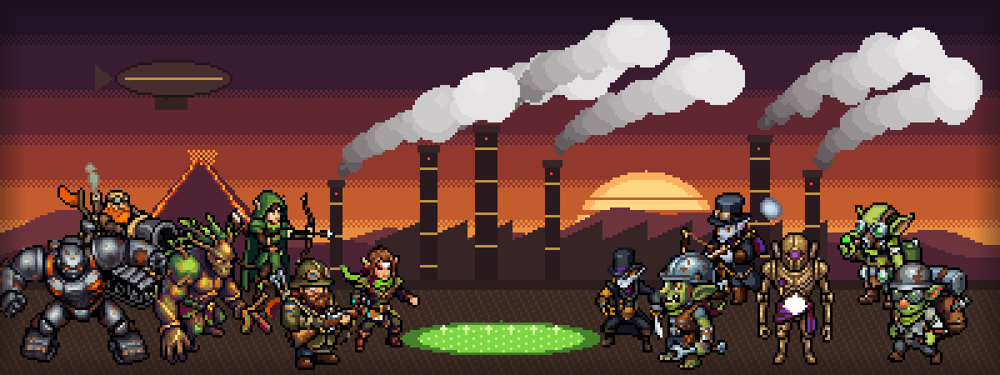

# Smokestack Symphony

**[Italiano](#italiano) · [English](#english)**

**▶ Gioca / Play:** https://rayuk-creator.github.io/smokestack-symphony/

---

## Italiano

Strategia in tempo reale in stile dieselpunk, con tocchi steampunk. Si gioca nel browser: Chrome su computer, telefono e tablet Android. Non serve installare niente.

Questa è una **versione di prova per gli amici tester**: ogni commento è benvenuto.

Il gioco è in **italiano e inglese**: la lingua si sceglie nella schermata iniziale (all'inizio segue quella del browser).

### Come si gioca
Parti con la base principale e cinque lavoratori già al lavoro. Raccogli le risorse della tua razza, costruisci, porta la base al livello 2 e **distruggi tutti gli edifici nemici** per vincere.

- **Modalità**: *Gioca* (tu contro il computer) oppure *Osserva* (il computer contro sé stesso).
- **Difficoltà**: Facile, Normale, Difficile.
- **Avversario**: scegli la razza oppure lascia "a caso".
- **Mappa**: cambia a ogni partita. Il fiume può essere di fanghi tossici, di lava o d'acqua, con ponti e passerelle in posizioni sempre diverse.
- La base ha due livelli. La popolazione massima è 55.

### Comandi
**Mouse e tastiera**: clic o riquadro per selezionare; clic su un nemico, un giacimento o il terreno per dare ordini (va bene anche il tasto destro). WASD o frecce e minimappa per muovere la visuale, rotella per lo zoom. Esc annulla.

**Telefono e tablet**: tocca per selezionare, doppio tocco per tutte le unità dello stesso tipo. Tocca un nemico, un giacimento o il terreno per dare ordini. Trascina per spostare la visuale, pizzica per lo zoom.

### Le quattro razze
| Razza | Chi sono | Risorse | Élite |
|---|---|---|---|
| **Durmagh** | Nani vulcanici | Magma | Magminator |
| **Thalren** | Elfi silvani | Linfa | Custode della foresta |
| **Vaelrith** | Elfi oscuri, setta steampunk che prega | Oro e preghiere | The Sealed |
| **Scrappers** | Goblin rottamai chimici | Rottami e fanghi tossici | Krankenstein |

### Se il gioco va a scatti
Nel menu di pausa trovi **Qualità grafica** (Alta, Media, Bassa). Il gioco la sceglie da solo e la abbassa se serve. Con **Info prestazioni** → *Copia i dati* puoi mandarci i numeri del tuo dispositivo: ci aiutano molto.

### Riconoscimenti
Personaggi, edifici e terreni disegnati con [PixelLab](https://www.pixellab.ai/). Grafica 3D con [Three.js](https://threejs.org/).

---

## English

A dieselpunk real-time strategy game with a touch of steampunk. It runs in the browser: Chrome on desktop, Android phones and tablets. Nothing to install.

This is a **test build for friends**: all feedback is welcome.

The game is in **English and Italian**: pick the language on the start screen (it first follows your browser's language).

### How to play
You start with your main base and five workers already gathering. Collect your race's resources, build, upgrade your base to level 2 and **destroy every enemy building** to win.

- **Mode**: *Play* (you against the computer) or *Watch* (computer against computer).
- **Difficulty**: Easy, Normal, Hard.
- **Opponent**: pick a race or leave it random.
- **Map**: different every game. The river can be toxic sludge, lava or water, with bridges and walkways in new places each time.
- Bases have two levels. Population cap is 55.

### Controls
**Mouse and keyboard**: click or drag a box to select; click an enemy, a resource node or the ground to give orders (right-click works too). WASD or arrow keys and the minimap move the camera, mouse wheel zooms. Esc cancels.

**Phone and tablet**: tap to select, double-tap to select all units of the same type. Tap an enemy, a resource node or the ground to give orders. Drag to move the camera, pinch to zoom.

### The four races
| Race | Who they are | Resources | Elite |
|---|---|---|---|
| **Durmagh** | Volcanic dwarves | Magma | Magminator |
| **Thalren** | Forest elves | Sap | Forest Warden |
| **Vaelrith** | Dark elves, a praying steampunk sect | Gold and prayers | The Sealed |
| **Scrappers** | Chemical scrapper goblins | Scrap and toxic sludge | Krankenstein |

### If the game stutters
The pause menu has **Graphics quality** (High, Medium, Low). The game picks one automatically and lowers it when needed. **Performance info** → *Copy data* lets you send us your device's numbers, which helps a lot.

### Credits
Characters, buildings and terrain drawn with [PixelLab](https://www.pixellab.ai/). 3D graphics with [Three.js](https://threejs.org/).
